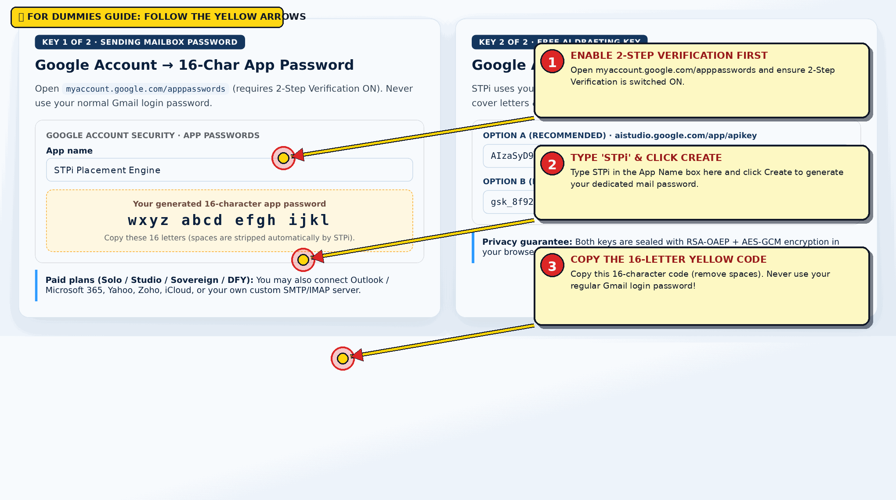
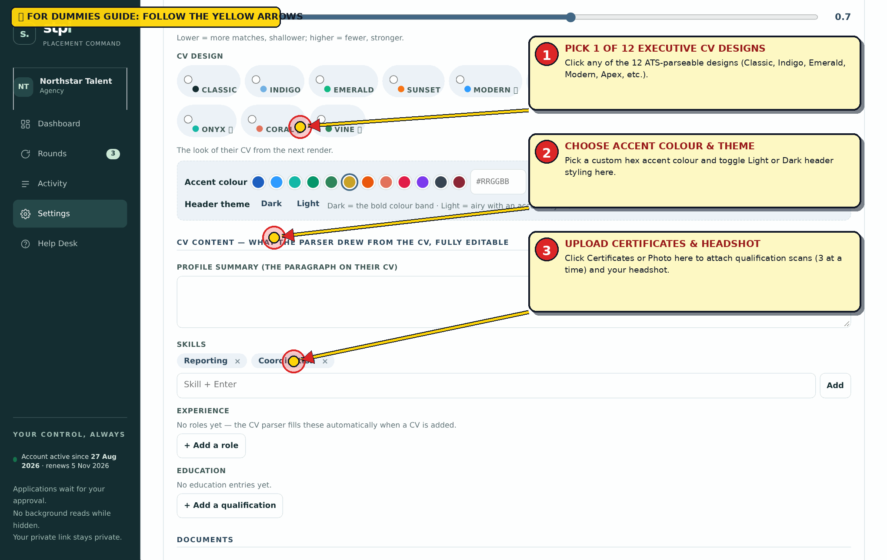
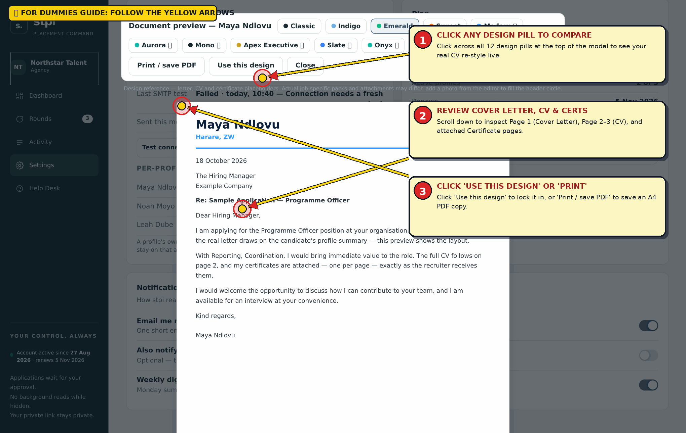
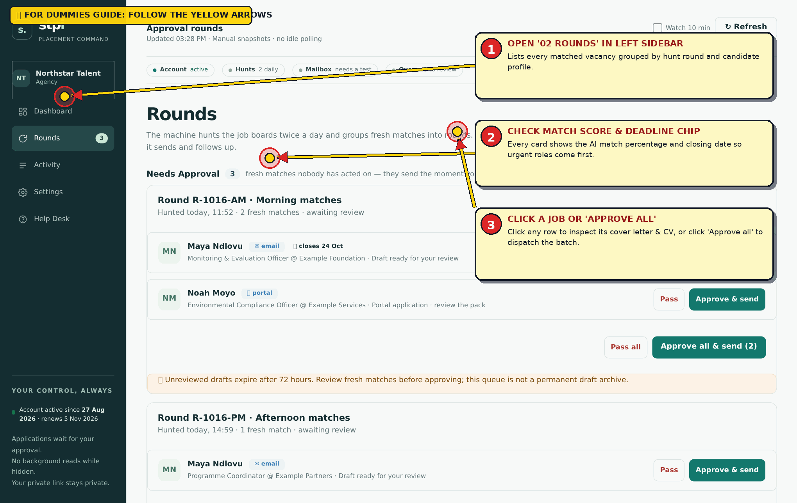
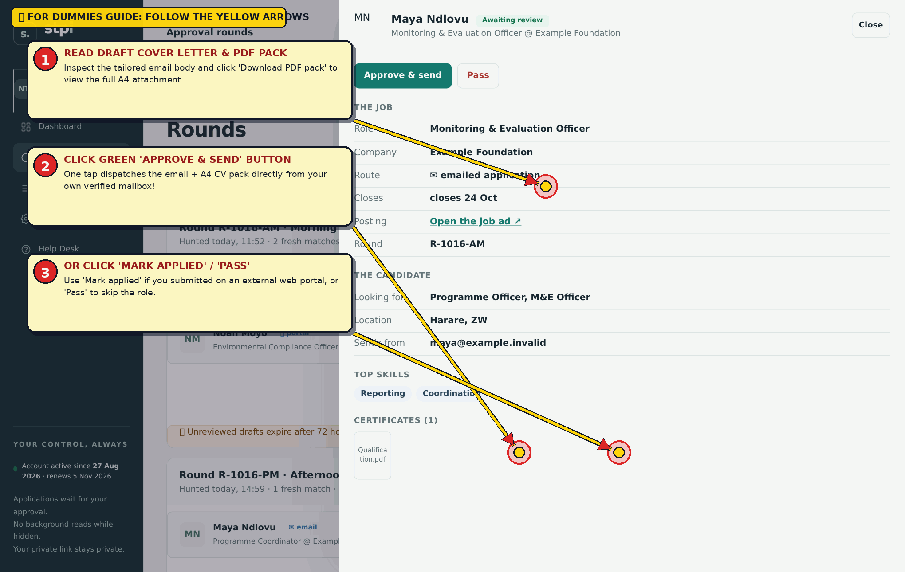
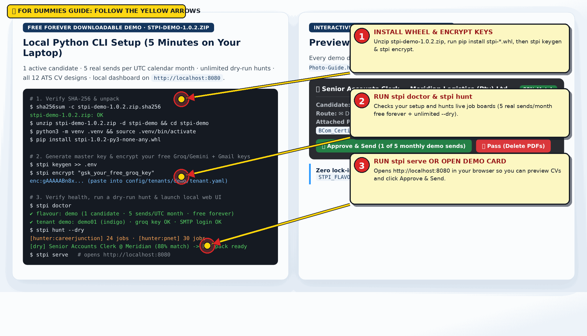

# Free Forever Downloadable Demo (stpi-demo-1.0.2.zip) — STPi 'For Dummies' Customer Photo & Video Guide

**Edition Badge:** `FREE FOREVER DEMO · LOCAL PYTHON WHEEL + DASHBOARD · $0 FOREVER`  
**Pricing & Term:** $0 Forever (No Account, No Card, Zero Telemetry)  
**Candidate Capacity:** 1 Active Candidate Profile (Local YAML) · **Monthly Sends:** 5 Live Sends per UTC Calendar Month Forever + Unlimited Dry-Run Hunts  

## 📦 All 4 Guide Formats + Mandatory Sales Contract

- **Interactive Browser Guide (HTML):** [`https://getstpi.pages.dev/guides/STPi-Photo-Guide-demo.html`](https://getstpi.pages.dev/guides/STPi-Photo-Guide-demo.html)
- **Printable Visual Handbook (PDF):** [`https://getstpi.pages.dev/guides/STPi-Photo-Guide-demo.pdf`](https://getstpi.pages.dev/guides/STPi-Photo-Guide-demo.pdf)
- **Annotated Markdown Guide (MD):** [`https://getstpi.pages.dev/guides/STPi-Photo-Guide-demo.md`](https://getstpi.pages.dev/guides/STPi-Photo-Guide-demo.md)
- **Step-by-Step Video Walkthrough (MP4):** [`https://getstpi.pages.dev/videos/STPi-Customer-Onboarding-Guide.mp4`](https://getstpi.pages.dev/videos/STPi-Customer-Onboarding-Guide.mp4)
- **Mandatory 7-Day Printable Sales Contract (PDF):** [`https://getstpi.pages.dev/downloads/STPi-Customer-Sales-Contract.pdf`](https://getstpi.pages.dev/downloads/STPi-Customer-Sales-Contract.pdf)

---

## ⚠️ MANDATORY CLIENT RULE: CONTACT US FIRST BEFORE PANICKING OR USING INTERNET ADVICE

> **CRITICAL CLIENT RULE:** If anything ever looks unfamiliar, if a mailbox test fails, or if you have a question at any step, ALWAYS contact STPi Official Support FIRST via WhatsApp (+263 78 460 0904), Email (simalidudu@gmail.com / tafadzwamchikanya@gmail.com), or any of our official social media channels listed below. Do NOT freak out, do NOT apply random advice from internet forums, and NEVER run to public social media or public review boards before contacting us first. STRICT POLICY: If we find that you ran to the public before contacting our team first to resolve your issue, we will immediately remove you and permanently terminate your workspace and licence without refund.

## 📝 MANDATORY 7-BUSINESS-DAY HAND-FILLED PDF SALES CONTRACT REQUIREMENT

> **MANDATORY WITHIN 7 BUSINESS DAYS OF PAYMENT:** Every paying customer must download the legally binding STPi Sales Contract (STPi-Customer-Sales-Contract.pdf), PRINT it on paper, FILL IT IN BY HAND in blue or black ink, SCAN or photograph all pages, and EMAIL the signed copy to simalidudu@gmail.com (or WhatsApp +263 78 460 0904) within the first SEVEN (7) BUSINESS DAYS after making payment. You MUST preserve your original physical wet-ink copy in a safe place, as we may request it at any time.

### 📞 Official STPi Company Social Accounts & Direct Support Directory

| Channel | Official Handle / Contact | Direct Link |
| :--- | :--- | :--- |
| **WhatsApp 24/7 Priority Support** | `+263 78 460 0904` | [https://wa.me/263784600904](https://wa.me/263784600904) |
| **Primary Support & Contract Email** | `simalidudu@gmail.com` | [mailto:simalidudu@gmail.com](mailto:simalidudu@gmail.com) |
| **Customer Care & Onboarding Email** | `tafadzwamchikanya@gmail.com` | [mailto:tafadzwamchikanya@gmail.com](mailto:tafadzwamchikanya@gmail.com) |
| **Official Website & Self-Serve Portal** | `getstpi.pages.dev` | [https://getstpi.pages.dev](https://getstpi.pages.dev) |
| **Whop Official Storefront & Community** | `whop.com/stpi` | [https://whop.com/stpi](https://whop.com/stpi) |
| **Whop Native App Website** | `stpi.whop.site` | [https://stpi.whop.site](https://stpi.whop.site) |
| **32-Video Library & Walkthroughs** | `getstpi.pages.dev/videos` | [https://getstpi.pages.dev/videos/](https://getstpi.pages.dev/videos/) |
| **LinkedIn Official Page & Team** | `linkedin.com/company/stpi` | [https://www.linkedin.com/company/stpi](https://www.linkedin.com/company/stpi) |
| **Bluesky Official Account** | `@stpi-official.bsky.social` | [https://bsky.app/profile/stpi-official.bsky.social](https://bsky.app/profile/stpi-official.bsky.social) |
| **Bluesky Founder & Support** | `@tariromalajila.bsky.social` | [https://bsky.app/profile/tariromalajila.bsky.social](https://bsky.app/profile/tariromalajila.bsky.social) |
| **Facebook Official Page** | `facebook.com/stpicareers` | [https://www.facebook.com/stpicareers](https://www.facebook.com/stpicareers) |
| **Pinterest Official Visual Boards** | `pinterest.com/tafadzwamchikanya/stpi-board` | [https://www.pinterest.com/tafadzwamchikanya/stpi-board/](https://www.pinterest.com/tafadzwamchikanya/stpi-board/) |
| **Dev.to Engineering & Career Guides** | `dev.to/simali_dud_b97add4154d7a6` | [https://dev.to/simali_dud_b97add4154d7a6](https://dev.to/simali_dud_b97add4154d7a6) |

---

## 🎯 How to Read This 'For Dummies' Visual Guide

Every screenshot below is taken directly from the real STPi pipeline and annotated with **numbered yellow speech bubbles (`①`, `②`, `③`) and red-tipped arrows** pointing to the exact input box, toggle, or button you need to edit or click.

**Your Onboarding → Operation Path:** Jump straight to Step 15 (Unzip stpi-demo-1.0.2.zip, pip install the wheel, run stpi keygen >> .env, encrypt your free Groq/Gemini key & Gmail App Password with stpi encrypt, edit demo01.yaml, and run stpi doctor, stpi hunt --dry, and stpi serve).

---

## Part 1 · Onboarding & Activation

### Step 2 of 16: Create Your 16-Character Gmail App Password & Free AI Key (Gemini or Groq)

**What you see on screen:** STPi sends applications from your own mailbox (so replies go straight to you and your candidate) and uses your own free-tier AI key (Google AI Studio Gemini or Groq) so you never pay per-draft markups.



#### 🎯 'For Dummies' Yellow Speech-Bubble & Arrow Callouts on This Screen

| Arrow / Bubble # | Exact Box / Button Pointed To | What You Must Type or Click |
| :---: | :--- | :--- |
| **Bubble (1)** | **ENABLE 2-STEP VERIFICATION FIRST** | Open myaccount.google.com/apppasswords and ensure 2-Step Verification is switched ON. |
| **Bubble (2)** | **TYPE 'STPi' & CLICK CREATE** | Type STPi in the App Name box here and click Create to generate your dedicated mail password. |
| **Bubble (3)** | **COPY THE 16-LETTER YELLOW CODE** | Copy this 16-character code (remove spaces). Never use your regular Gmail login password! |

#### Step-by-Step Instructions

1. **Create your Gmail App Password (2 minutes):** Open `https://myaccount.google.com/apppasswords` (ensure 2-Step Verification is switched ON first). Type `STPi` as the app name, click **Create**, and copy the 16-character password (`wxyz abcd efgh ijkl`). Never paste your regular Google account password.
2. **Create your Free AI Key (1 minute):** Open `https://aistudio.google.com/app/apikey` (Google Gemini — recommended) or `https://console.groq.com/keys` (Groq). Click **Create API key** — no credit card required — and copy the key (`AIza...` or `gsk_...`).
3. **Paid Plan Non-Gmail Mailboxes:** On Solo, Studio, Sovereign, Done-For-You, and CV Setup, you can also use Outlook / Microsoft 365, Yahoo, Zoho, iCloud, or your own custom SMTP/IMAP server.

#### Real Example · What Valid Keys Look Like

```text
• Mailbox Address: `placements@northstartalent.co.za` (or `simalidudu@gmail.com`)
• Gmail App Password: `wxyz abcd efgh ijkl` (16 letters; spaces are stripped automatically)
• Gemini API Key: `AIzaSyD9_example_free_gemini_flash_key_84920` (or Groq: `gsk_8f92aB3c...`)
```

> **Stuck on this step?** Do NOT panic or follow random internet advice! Message us first on **WhatsApp (`+263 78 460 0904`)** or email **`simalidudu@gmail.com`** / **`tafadzwamchikanya@gmail.com`**.

---

## Part 2 · Candidate Profiles, CVs & Certificates (#settings)

### Step 7 of 16: Pick from All 12 ATS CV Designs, Custom Accents & Attach Certificates (Up to 3 per Batch)

**What you see on screen:** Every candidate card features one-click swatches for all 12 ATS-parseable CV designs (`Classic`, `Indigo`, `Emerald`, `Sunset`, `Modern`, `Aurora`, `Mono`, `Apex Executive`, `Slate`, `Onyx`, `Coral`, `Vine`), plus buttons for **CV**, **Certificates**, **Photo**, and **Mailbox**.



#### 🎯 'For Dummies' Yellow Speech-Bubble & Arrow Callouts on This Screen

| Arrow / Bubble # | Exact Box / Button Pointed To | What You Must Type or Click |
| :---: | :--- | :--- |
| **Bubble (1)** | **PICK 1 OF 12 EXECUTIVE CV DESIGNS** | Click any of the 12 ATS-parseable designs (Classic, Indigo, Emerald, Modern, Apex, etc.). |
| **Bubble (2)** | **CHOOSE ACCENT COLOUR & THEME** | Pick a custom hex accent colour and toggle Light or Dark header styling here. |
| **Bubble (3)** | **UPLOAD CERTIFICATES & HEADSHOT** | Click Certificates or Photo here to attach qualification scans (3 at a time) and your headshot. |

#### Step-by-Step Instructions

1. **Pick a CV Design:** Click any of the 12 design swatches on the candidate card (or inside Edit Profile) to switch their CV look immediately. Modern (`Modern`, `Aurora`, `Mono`) and Executive (`Apex`, `Slate`, `Onyx`, `Coral`, `Vine`) designs also unlock **Custom Accent Colours** (`#RRGGBB`) and **Dark / Light Header Themes**.
2. **Attach Qualification Certificates (Mandatory before sending):** Click **Certificates** on the candidate card, select up to **3 files at a time** (`.pdf`, `.jpg`, `.png`, up to 8 MB each), and click **Attach**. Need more than 3 certificates? Simply click **Certificates** again — new files merge automatically by filename!
3. **Optional Headshot Photo:** Click **Photo** to attach a `.jpg`/`.png`/`.webp` portrait for the photo-slot CV designs (`Modern`, `Aurora`, `Mono`, `Apex`, `Slate`, `Onyx`, `Coral`, `Vine`).

#### Real Example · Merging 5 Certificates in Two Batches

```text
• Batch 1: Select `BSc_Hons_Degree.pdf`, `Project_Management_Cert.pdf`, and `Drivers_Licence.pdf` → Click **Attach**.
• Batch 2: Click **Certificates** again (leave 'Replace current set' unticked) → Select `SHEQ_Diploma.pdf` and `First_Aid.pdf` → Click **Attach**. All 5 certificates now ride with every application!
```

> **Stuck on this step?** Do NOT panic or follow random internet advice! Message us first on **WhatsApp (`+263 78 460 0904`)** or email **`simalidudu@gmail.com`** / **`tafadzwamchikanya@gmail.com`**.

### Step 8 of 16: Inspect the Live Multi-Page A4 Preview (Cover Letter + Tailored CV + Certificates)

**What you see on screen:** Clicking **Preview CV & pack** opens the interactive full-screen Document Preview Modal (`#pvwrap`). It renders Page 1 (the business-plain Cover Letter), Page 2 (the styled A4 CV in your chosen theme, accent, and Dark/Light header mode), and Page 3+ (each attached qualification certificate on its own page).



#### 🎯 'For Dummies' Yellow Speech-Bubble & Arrow Callouts on This Screen

| Arrow / Bubble # | Exact Box / Button Pointed To | What You Must Type or Click |
| :---: | :--- | :--- |
| **Bubble (1)** | **CLICK ANY DESIGN PILL TO COMPARE** | Click across all 12 design pills at the top of the modal to see your real CV re-style live. |
| **Bubble (2)** | **REVIEW COVER LETTER, CV & CERTS** | Scroll down to inspect Page 1 (Cover Letter), Page 2–3 (CV), and attached Certificate pages. |
| **Bubble (3)** | **CLICK 'USE THIS DESIGN' OR 'PRINT'** | Click 'Use this design' to lock it in, or 'Print / save PDF' to save an A4 PDF copy. |

#### Step-by-Step Instructions

1. On any candidate card in **Settings**, click **Preview CV & pack**.
2. Click through all **12 CV design pills** across the top of the preview bar (`Classic` through `Vine`), test **Accent colour dots**, and toggle **Dark / Light header** to compare styles live.
3. Click **Use this design for <Candidate>** to lock in your favourite look for all future applications.
4. Press `Escape` or click **Close** to return to your workspace without losing your scroll position.

#### Real Example · Choosing Between Emerald, Modern & Apex Executive

```text
• NGO / Development Roles (`Maya Ndlovu`): `Emerald` or `Vine` with Light header.
• Corporate Finance / Executive Roles (`Lerato Mokoena`): `Apex Executive` with `#C9A227` gold accent & Dark band.
• Engineering / Tech Roles (`Noah Moyo`): `Modern` or `Slate` with `#2E9BFF` cobalt accent.
```

> **Stuck on this step?** Do NOT panic or follow random internet advice! Message us first on **WhatsApp (`+263 78 460 0904`)** or email **`simalidudu@gmail.com`** / **`tafadzwamchikanya@gmail.com`**.

---

## Part 3 · Daily Operation: Reviewing, Approving & Tracking

### Step 11 of 16: Rounds View (#rounds) — Batch-Review Daily Hunt Matches

**What you see on screen:** Clicking **Rounds** in the sidebar groups all researched job matches by hunt batch (`R-1018-AM · Morning matches`, `R-1018-PM · Afternoon matches`). Each card displays the candidate name, job title, employer, relevance score (`89%`), application route (`✉️ emailed application` vs `📦 portal apply pack`), and closing date countdown.



#### 🎯 'For Dummies' Yellow Speech-Bubble & Arrow Callouts on This Screen

| Arrow / Bubble # | Exact Box / Button Pointed To | What You Must Type or Click |
| :---: | :--- | :--- |
| **Bubble (1)** | **OPEN '02 ROUNDS' IN LEFT SIDEBAR** | Lists every matched vacancy grouped by hunt round and candidate profile. |
| **Bubble (2)** | **CHECK MATCH SCORE & DEADLINE CHIP** | Every card shows the AI match percentage and closing date so urgent roles come first. |
| **Bubble (3)** | **CLICK A JOB OR 'APPROVE ALL'** | Click any row to inspect its cover letter & CV, or click 'Approve all' to dispatch the batch. |

#### Step-by-Step Instructions

1. Click **Rounds** in the navigation bar to see every open and recent hunt batch.
2. Notice the two application routes:
  1. **✉️ Emailed application:** The job advert includes a recruitment email address. Tapping **Approve & send** emails the tailored cover letter, CV PDF, and attached certificates directly from your mailbox.
  2. **📦 Portal apply pack:** The employer requires an online web form (e.g. Workday/SuccessFactors). STPi prepares the tailored PDF pack and cover letter so you can upload it in 30 seconds and click **Mark applied**.
3. Want to approve or skip an entire batch at once? Use **Approve all & send (n)** or **Pass all** on the round header.

#### Real Example · Morning Hunt Round R-1018-AM

```text
• Match 1: `Maya Ndlovu` → `Monitoring & Evaluation Officer @ Example Foundation` · `89% match` · `✉️ emailed application` · `Closes in 6 days`.
• Match 2: `Noah Moyo` → `Environmental Compliance Officer @ Example Services` · `84% match` · `📦 portal apply pack`.
```

> **Stuck on this step?** Do NOT panic or follow random internet advice! Message us first on **WhatsApp (`+263 78 460 0904`)** or email **`simalidudu@gmail.com`** / **`tafadzwamchikanya@gmail.com`**.

### Step 12 of 16: Inspect the Application Drawer, Download Apply Packs & Tap Approve & Send

**What you see on screen:** Clicking any match card in **Overview** or **Rounds** slides open the detailed **Application Inspection Drawer** (`#slide`). It shows the full tailored cover letter, recipient address, downloadable PDF apply pack, original job posting link, candidate profile summary, and the primary action buttons.



#### 🎯 'For Dummies' Yellow Speech-Bubble & Arrow Callouts on This Screen

| Arrow / Bubble # | Exact Box / Button Pointed To | What You Must Type or Click |
| :---: | :--- | :--- |
| **Bubble (1)** | **READ DRAFT COVER LETTER & PDF PACK** | Inspect the tailored email body and click 'Download PDF pack' to view the full A4 attachment. |
| **Bubble (2)** | **CLICK GREEN 'APPROVE & SEND' BUTTON** | One tap dispatches the email + A4 CV pack directly from your own verified mailbox! |
| **Bubble (3)** | **OR CLICK 'MARK APPLIED' / 'PASS'** | Use 'Mark applied' if you submitted on an external web portal, or 'Pass' to skip the role. |

#### Step-by-Step Instructions

1. Click any match card to open the right-hand **Application Drawer**.
2. Read the tailored cover letter and verify the role details (`Open the job ad ↗` opens the live vacancy source).
3. Choose your action:
  • **Approve & send:** Immediately queues the email send (dispatches `decide.yml` and delivers via your SMTP mailbox within ~60 seconds).
  • **Pass:** Permanently skips this vacancy and deletes its temporary draft PDFs.
  • **Copy letter / Download PDFs + Mark applied (Portal route):** For portal vacancies, download the tailored CV PDF, click **Copy letter**, submit on the employer's portal, and click **Mark applied**.

#### Real Example · The Golden Rule of STPi

```text
Nothing ever sends without your explicit tap on **Approve & send**. Unreviewed drafts automatically expire and purge their temporary PDFs after 72 hours so stale jobs never clutter your queue.
```

> **Stuck on this step?** Do NOT panic or follow random internet advice! Message us first on **WhatsApp (`+263 78 460 0904`)** or email **`simalidudu@gmail.com`** / **`tafadzwamchikanya@gmail.com`**.

---

## Part 4 · Self-Hosted Editions (Free Forever Demo & Sovereign Docker)

### Step 15 of 16: Free Forever Downloadable Demo (stpi-demo-1.0.2.zip) — Local CLI & Dashboard

**What you see on screen:** The downloadable demo (`stpi-demo-1.0.2.zip` + `stpi-demo-kit.zip`) runs the genuine STPi Python wheel (`stpi-1.0.2-py3-none-any.whl`) on your laptop. It includes 1 active candidate, 5 real sends per UTC month forever, unlimited `--dry` hunts, all 12 CV designs, and the local web UI on `http://localhost:8080`.



#### 🎯 'For Dummies' Yellow Speech-Bubble & Arrow Callouts on This Screen

| Arrow / Bubble # | Exact Box / Button Pointed To | What You Must Type or Click |
| :---: | :--- | :--- |
| **Bubble (1)** | **INSTALL WHEEL & ENCRYPT KEYS** | Unzip stpi-demo-1.0.2.zip, run pip install stpi-*.whl, then stpi keygen & stpi encrypt. |
| **Bubble (2)** | **RUN stpi doctor & stpi hunt** | Checks your setup and hunts live job boards (5 real sends/month free forever + unlimited --dry). |
| **Bubble (3)** | **RUN stpi serve OR OPEN DEMO CARD** | Opens http://localhost:8080 in your browser so you can preview CVs and click Approve & Send. |

#### Step-by-Step Instructions

1. **Verify & Unpack:** Download `stpi-demo-1.0.2.zip` and `stpi-demo-1.0.2.zip.sha256` from `https://getstpi.pages.dev/demo`. Verify the checksum (`sha256sum -c stpi-demo-1.0.2.zip.sha256`), unzip, create a Python 3.11+ virtualenv, and run `pip install stpi-1.0.2-py3-none-any.whl`.
2. **Encrypt Your Free Keys:** Run `stpi keygen >> .env` to create your local Fernet master key. Then run `stpi encrypt "gsk_..."` for your free Groq/Gemini key and paste the encrypted output into `config/tenants/demo/tenant.yaml` under `llm_api_key:` (and do the same for your Gmail App Password under `mailbox.app_password:`).
3. **Configure Your Candidate:** Edit `config/tenants/demo/candidates/demo01.yaml` with your candidate's real name, email, country (`ZA`, `ZW`, `ZM`, etc.), skills, experience, and `cv_design:` (`classic`, `indigo`, `emerald`, `sunset`, `apex`, etc.).
4. **Check Health, Hunt & Serve:** Run `stpi doctor` to verify all checks are green, `stpi hunt --dry` to preview real scored job matches without sending, `stpi hunt` to generate real PDF packs, and `stpi serve` to open your local dashboard at `http://localhost:8080`.

#### Real Example · Complete 6-Command Local Demo Loop

```text
unzip stpi-demo-1.0.2.zip -d stpi-demo && cd stpi-demo
python3 -m venv .venv && source .venv/bin/activate
pip install stpi-1.0.2-py3-none-any.whl
stpi keygen >> .env && stpi encrypt "gsk_your_free_key"
stpi doctor && stpi hunt --dry
stpi serve   # Open http://localhost:8080 in any browser
```

> **Stuck on this step?** Do NOT panic or follow random internet advice! Message us first on **WhatsApp (`+263 78 460 0904`)** or email **`simalidudu@gmail.com`** / **`tafadzwamchikanya@gmail.com`**.
