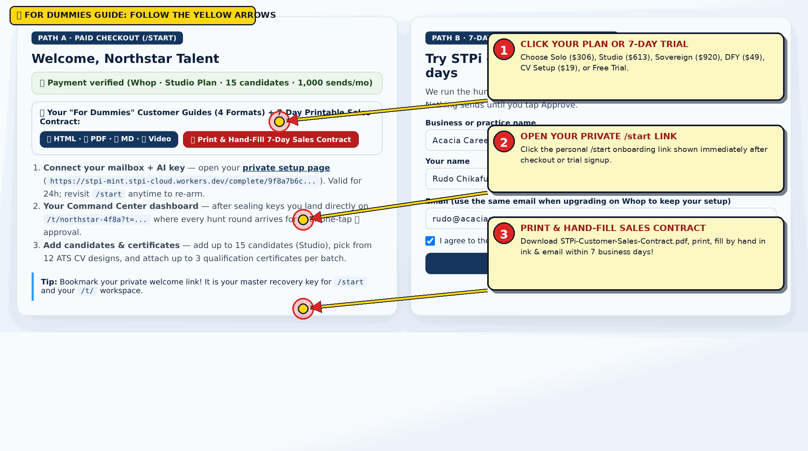
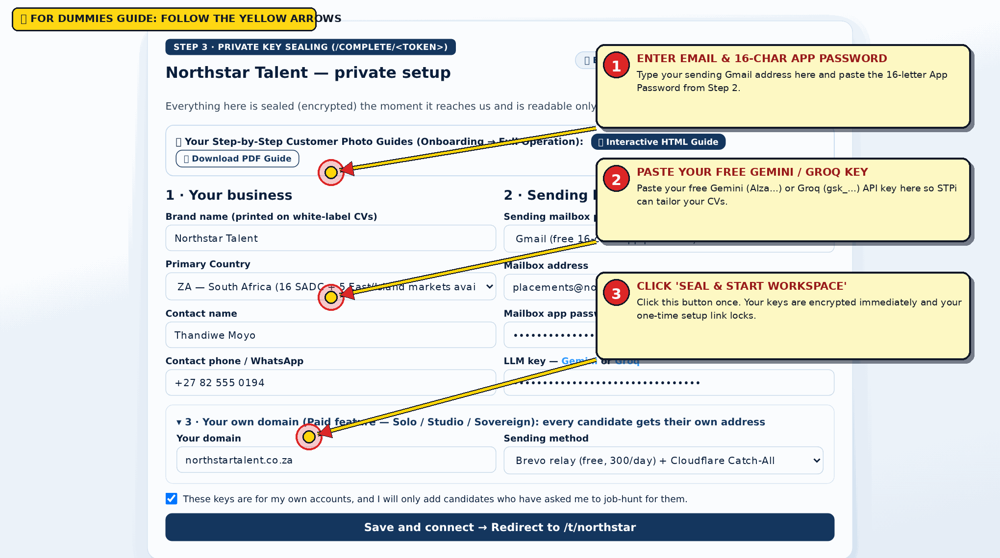
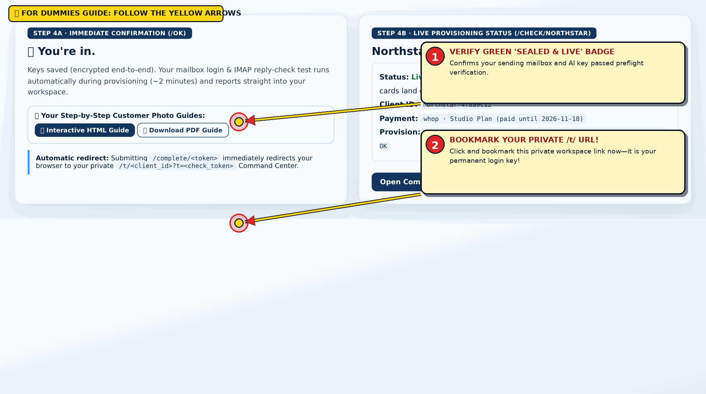
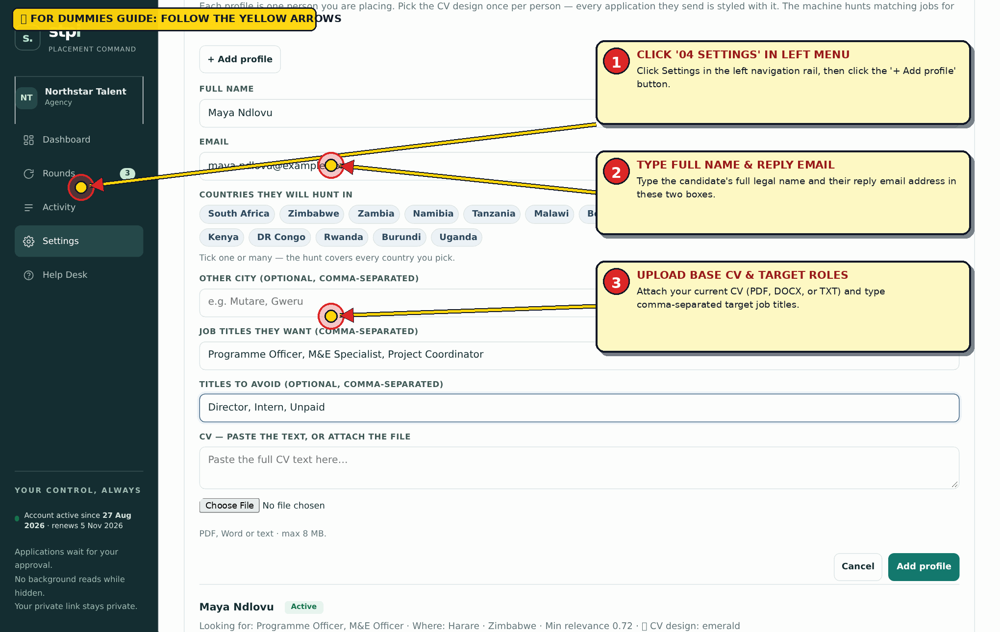
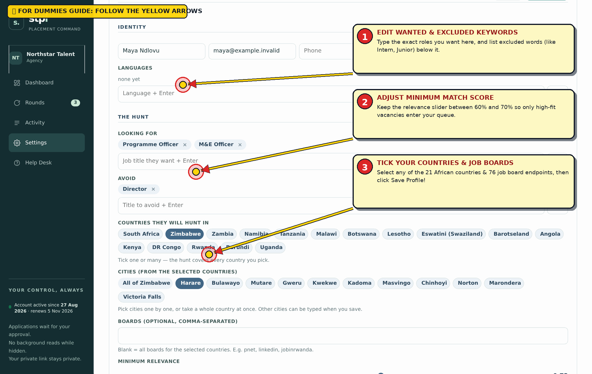
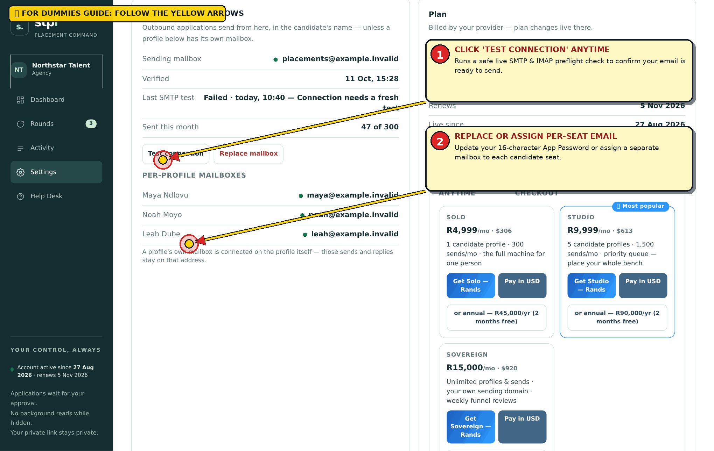
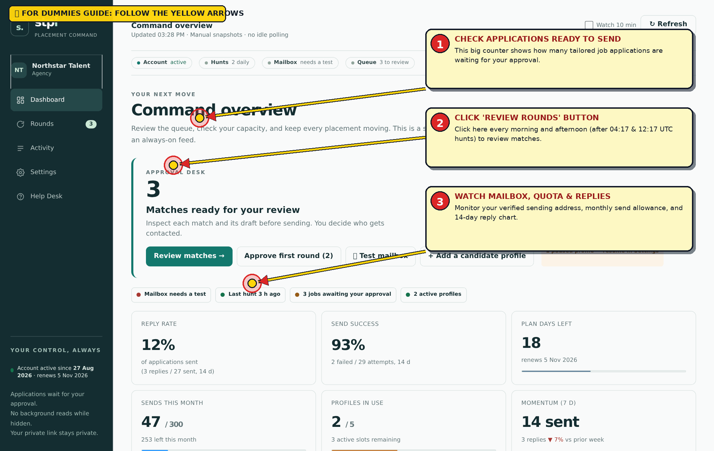
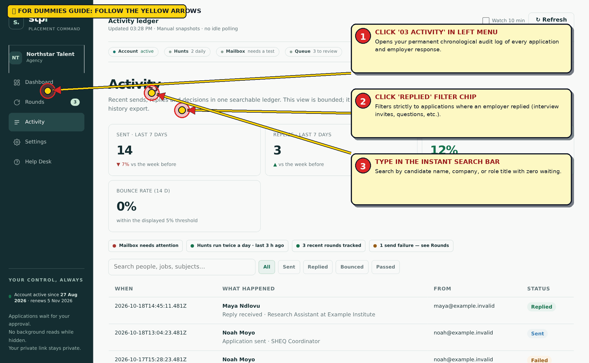
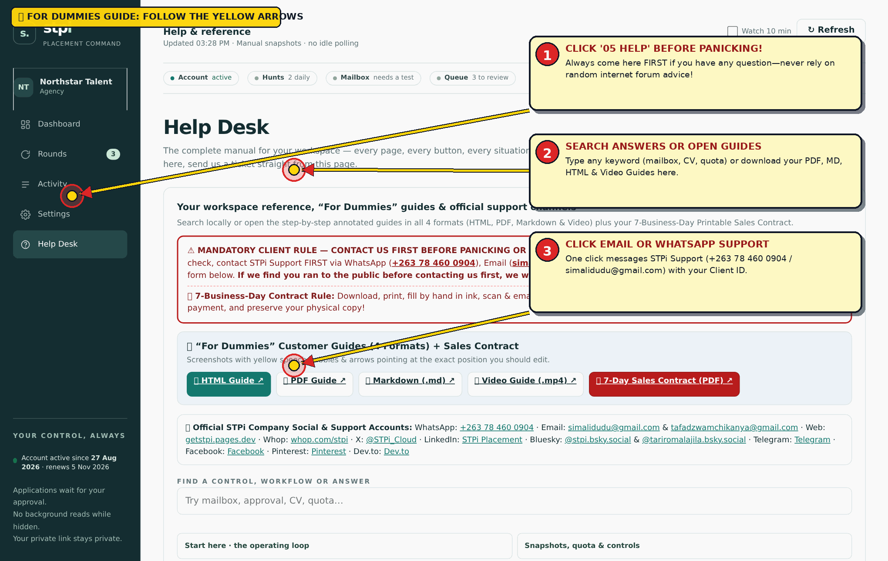

# STPi Studio (Multi-Candidate Agency) — STPi 'For Dummies' Customer Photo & Video Guide

**Edition Badge:** `STUDIO PLAN · WHITE-LABEL AGENCY · UP TO 15 CANDIDATES`  
**Pricing & Term:** $613/mo (about R9,999/mo) · or $5,517/yr (25% off)  
**Candidate Capacity:** Up to 15 Active Candidate Profiles · **Monthly Sends:** 1,000 Approved Applications / month  

## 📦 All 4 Guide Formats + Mandatory Sales Contract

- **Interactive Browser Guide (HTML):** [`https://getstpi.pages.dev/guides/STPi-Photo-Guide-studio.html`](https://getstpi.pages.dev/guides/STPi-Photo-Guide-studio.html)
- **Printable Visual Handbook (PDF):** [`https://getstpi.pages.dev/guides/STPi-Photo-Guide-studio.pdf`](https://getstpi.pages.dev/guides/STPi-Photo-Guide-studio.pdf)
- **Annotated Markdown Guide (MD):** [`https://getstpi.pages.dev/guides/STPi-Photo-Guide-studio.md`](https://getstpi.pages.dev/guides/STPi-Photo-Guide-studio.md)
- **Step-by-Step Video Walkthrough (MP4):** [`https://getstpi.pages.dev/videos/STPi-Customer-Onboarding-Guide.mp4`](https://getstpi.pages.dev/videos/STPi-Customer-Onboarding-Guide.mp4)
- **Mandatory 7-Day Printable Sales Contract (PDF):** [`https://getstpi.pages.dev/downloads/STPi-Customer-Sales-Contract.pdf`](https://getstpi.pages.dev/downloads/STPi-Customer-Sales-Contract.pdf)

---

## ⚠️ MANDATORY CLIENT RULE: CONTACT US FIRST BEFORE PANICKING OR USING INTERNET ADVICE

> **CRITICAL CLIENT RULE:** If anything ever looks unfamiliar, if a mailbox test fails, or if you have a question at any step, ALWAYS contact STPi Official Support FIRST via WhatsApp (+263 78 460 0904), Email (simalidudu@gmail.com / tafadzwamchikanya@gmail.com), or any of our official social media channels listed below. Do NOT freak out, do NOT apply random advice from internet forums, and NEVER run to public social media or public review boards before contacting us first. STRICT POLICY: If we find that you ran to the public before contacting our team first to resolve your issue, we will immediately remove you and permanently terminate your workspace and licence without refund.

## 📝 MANDATORY 7-BUSINESS-DAY HAND-FILLED PDF SALES CONTRACT REQUIREMENT

> **MANDATORY WITHIN 7 BUSINESS DAYS OF PAYMENT:** Every paying customer must download the legally binding STPi Sales Contract (STPi-Customer-Sales-Contract.pdf), PRINT it on paper, FILL IT IN BY HAND in blue or black ink, SCAN or photograph all pages, and EMAIL the signed copy to simalidudu@gmail.com (or WhatsApp +263 78 460 0904) within the first SEVEN (7) BUSINESS DAYS after making payment. You MUST preserve your original physical wet-ink copy in a safe place, as we may request it at any time.

### 📞 Official STPi Company Social Accounts & Direct Support Directory

| Channel | Official Handle / Contact | Direct Link |
| :--- | :--- | :--- |
| **WhatsApp 24/7 Priority Support** | `+263 78 460 0904` | [https://wa.me/263784600904](https://wa.me/263784600904) |
| **Primary Support & Contract Email** | `simalidudu@gmail.com` | [mailto:simalidudu@gmail.com](mailto:simalidudu@gmail.com) |
| **Customer Care & Onboarding Email** | `tafadzwamchikanya@gmail.com` | [mailto:tafadzwamchikanya@gmail.com](mailto:tafadzwamchikanya@gmail.com) |
| **Official Website & Self-Serve Portal** | `getstpi.pages.dev` | [https://getstpi.pages.dev](https://getstpi.pages.dev) |
| **Whop Official Storefront & Community** | `whop.com/stpi` | [https://whop.com/stpi](https://whop.com/stpi) |
| **Whop Native App Website** | `stpi.whop.site` | [https://stpi.whop.site](https://stpi.whop.site) |
| **32-Video Library & Walkthroughs** | `getstpi.pages.dev/videos` | [https://getstpi.pages.dev/videos/](https://getstpi.pages.dev/videos/) |
| **X (Twitter) Official Channel** | `@STPi_Cloud` | [https://x.com/STPi_Cloud](https://x.com/STPi_Cloud) |
| **LinkedIn Official Page & Team** | `linkedin.com/company/stpi` | [https://www.linkedin.com/company/stpi](https://www.linkedin.com/company/stpi) |
| **Bluesky Official Account** | `@stpi-official.bsky.social` | [https://bsky.app/profile/stpi-official.bsky.social](https://bsky.app/profile/stpi-official.bsky.social) |
| **Bluesky Founder & Support** | `@tariromalajila.bsky.social` | [https://bsky.app/profile/tariromalajila.bsky.social](https://bsky.app/profile/tariromalajila.bsky.social) |
| **Facebook Official Page** | `facebook.com/stpicareers` | [https://www.facebook.com/stpicareers](https://www.facebook.com/stpicareers) |
| **Pinterest Official Visual Boards** | `pinterest.com/tafadzwamchikanya/stpi-board` | [https://www.pinterest.com/tafadzwamchikanya/stpi-board/](https://www.pinterest.com/tafadzwamchikanya/stpi-board/) |
| **Dev.to Engineering & Career Guides** | `dev.to/simali_dud_b97add4154d7a6` | [https://dev.to/simali_dud_b97add4154d7a6](https://dev.to/simali_dud_b97add4154d7a6) |

---

## 🎯 How to Read This 'For Dummies' Visual Guide

Every screenshot below is taken directly from the real STPi pipeline and annotated with **numbered yellow speech bubbles (`①`, `②`, `③`) and red-tipped arrows** pointing to the exact input box, toggle, or button you need to edit or click.

**Your Onboarding → Operation Path:** Step 1 (/start welcome link) → Step 2 (Mailbox + LLM keys) → Step 3 (Seal keys + Section 3 Own-Domain Relay on /complete) → Steps 5–9 (Add up to 15 candidates, per-candidate mailboxes, 12 CV themes & certificates) → Steps 10–14 (Batch-approve rounds & monitor 14-day agency funnel).

---

## Part 1 · Onboarding & Activation

### Step 1 of 16: Activate Your Workspace (/start) or Start a 7-Day Free Trial (/trial)

**What you see on screen:** Immediately after purchasing any plan on Whop (Solo, Studio, Sovereign, Done-For-You $49/mo, or Executive CV Setup $19) — or signing up at /trial — you receive your private welcome link (/start?t=<check_token>). Opening it displays your Customer Photo Guides (Interactive HTML + PDF) and arms your 24-hour private setup link (/complete/<enroll_token>).



#### 🎯 'For Dummies' Yellow Speech-Bubble & Arrow Callouts on This Screen

| Arrow / Bubble # | Exact Box / Button Pointed To | What You Must Type or Click |
| :---: | :--- | :--- |
| **Bubble (1)** | **CLICK YOUR PLAN OR 7-DAY TRIAL** | Choose Solo ($306), Studio ($613), Sovereign ($920), DFY ($49), CV Setup ($19), or Free Trial. |
| **Bubble (2)** | **OPEN YOUR PRIVATE /start LINK** | Click the personal /start onboarding link shown immediately after checkout or trial signup. |
| **Bubble (3)** | **PRINT & HAND-FILL SALES CONTRACT** | Download STPi-Customer-Sales-Contract.pdf, print, fill by hand in ink & email within 7 business days! |

#### Step-by-Step Instructions

1. Open the private welcome link supplied after checkout (`https://stpi-mint.stpi-cloud.workers.dev/start?t=<your_token>`) and enter the exact email address you used at checkout.
2. Starting a 7-Day Free Trial instead? Visit `https://stpi-mint.stpi-cloud.workers.dev/trial`, enter your practice name, your name, email, and primary country, and click **Start my 7-day trial**.
3. Download or open your **Interactive HTML Photo Guide** and **PDF Photo Guide** from the blue banner at the top of the welcome screen.
4. Click **private setup page** (`/complete/<token>`) to proceed to Step 2 and Step 3.

#### Real Example · Agency Buyer vs. Trial User

```text
• Studio Buyer: Thandiwe buys STPi Studio ($613/mo) on Whop using `placements@northstartalent.co.za`. She opens her `/start?t=...` link, enters `placements@northstartalent.co.za`, and clicks her armed `/complete/...` link.
• Trial User: Rudo signs up at `/trial` with `rudo@acaciacareers.co.zw`. Later, when she buys Solo on Whop with that same email, STPi automatically upgrades her trial workspace in place — keeping every candidate and draft.
```

> **Stuck on this step?** Do NOT panic or follow random internet advice! Message us first on **WhatsApp (`+263 78 460 0904`)** or email **`simalidudu@gmail.com`** / **`tafadzwamchikanya@gmail.com`**.

### Step 2 of 16: Create Your 16-Character Gmail App Password & Free AI Key (Gemini or Groq)

**What you see on screen:** STPi sends applications from your own mailbox (so replies go straight to you and your candidate) and uses your own free-tier AI key (Google AI Studio Gemini or Groq) so you never pay per-draft markups.


#### 🎯 'For Dummies' Yellow Speech-Bubble & Arrow Callouts on This Screen

| Arrow / Bubble # | Exact Box / Button Pointed To | What You Must Type or Click |
| :---: | :--- | :--- |
| **Bubble (1)** | **ENABLE 2-STEP VERIFICATION FIRST** | Open myaccount.google.com/apppasswords and ensure 2-Step Verification is switched ON. |
| **Bubble (2)** | **TYPE 'STPi' & CLICK CREATE** | Type STPi in the App Name box here and click Create to generate your dedicated mail password. |
| **Bubble (3)** | **COPY THE 16-LETTER YELLOW CODE** | Copy this 16-character code (remove spaces). Never use your regular Gmail login password! |

#### Step-by-Step Instructions

1. **Create your Gmail App Password (2 minutes):** Open `https://myaccount.google.com/apppasswords` (ensure 2-Step Verification is switched ON first). Type `STPi` as the app name, click **Create**, and copy the 16-character password (`wxyz abcd efgh ijkl`). Never paste your regular Google account password.
2. **Create your Free AI Key (1 minute):** Open `https://aistudio.google.com/app/apikey` (Google Gemini — recommended) or `https://console.groq.com/keys` (Groq). Click **Create API key** — no credit card required — and copy the key (`AIza...` or `gsk_...`).
3. **Paid Plan Non-Gmail Mailboxes:** On Solo, Studio, Sovereign, Done-For-You, and CV Setup, you can also use Outlook / Microsoft 365, Yahoo, Zoho, iCloud, or your own custom SMTP/IMAP server.

#### Real Example · What Valid Keys Look Like

```text
• Mailbox Address: `placements@northstartalent.co.za` (or `simalidudu@gmail.com`)
• Gmail App Password: `wxyz abcd efgh ijkl` (16 letters; spaces are stripped automatically)
• Gemini API Key: `AIzaSyD9_example_free_gemini_flash_key_84920` (or Groq: `gsk_8f92aB3c...`)
```

> **Stuck on this step?** Do NOT panic or follow random internet advice! Message us first on **WhatsApp (`+263 78 460 0904`)** or email **`simalidudu@gmail.com`** / **`tafadzwamchikanya@gmail.com`**.

### Step 3 of 16: Complete Your Private Setup Form (/complete/<token>) & Seal Your Keys

**What you see on screen:** The `/complete/<token>` page collects your brand name, primary country, contact details, sending mailbox credentials, AI key, and optional custom sender domain. All credentials are encrypted end-to-end (RSA-OAEP + AES-256-GCM) before leaving your browser.



#### 🎯 'For Dummies' Yellow Speech-Bubble & Arrow Callouts on This Screen

| Arrow / Bubble # | Exact Box / Button Pointed To | What You Must Type or Click |
| :---: | :--- | :--- |
| **Bubble (1)** | **ENTER EMAIL & 16-CHAR APP PASSWORD** | Type your sending Gmail address here and paste the 16-letter App Password from Step 2. |
| **Bubble (2)** | **PASTE YOUR FREE GEMINI / GROQ KEY** | Paste your free Gemini (AIza...) or Groq (gsk_...) API key here so STPi can tailor your CVs. |
| **Bubble (3)** | **CLICK 'SEAL & START WORKSPACE'** | Click this button once. Your keys are encrypted immediately and your one-time setup link locks. |

#### Step-by-Step Instructions

1. **Section 1 · Your business:** Enter your **Brand name** (printed on candidate CVs on Studio/Sovereign), select your **Country** across our 16 SADC + 5 East/Island markets (`ZA, ZW, ZM, NA, TZ, MW, BW, LS, SZ, XB, AO, KE, CD, RW, BI, UG`), and enter your name and WhatsApp number.
2. **Section 2 · Sending keys:** Select your mailbox provider (`Gmail`, `Outlook`, `Yahoo`, `Zoho`, `iCloud`, or `My own SMTP/IMAP server`), enter the mailbox address, paste your 16-character App Password, and paste your Gemini or Groq API key.
3. **Section 3 · Your own domain (Optional, Paid Plans):** Expand Section 3 if you want every candidate to send from `candidate.name@yourdomain.co.za` via free Brevo (300/day), SMTP2GO (1,000/mo), or your own SMTP server.
4. Tick the consent confirmation checkbox and click **Save and connect**.

#### Real Example · Own-Domain Sending for an Agency

```text
• Brand Name: `Northstar Talent` · Country: `ZA (South Africa)`
• Section 2 Reply Inbox: `placements@northstartalent.co.za` (receives all employer replies via catch-all)
• Section 3 Custom Domain: `northstartalent.co.za` via `Brevo relay` → Maya's applications send from `maya.ndlovu@northstartalent.co.za`.
```

> **Stuck on this step?** Do NOT panic or follow random internet advice! Message us first on **WhatsApp (`+263 78 460 0904`)** or email **`simalidudu@gmail.com`** / **`tafadzwamchikanya@gmail.com`**.

### Step 4 of 16: Automatic Provisioning, Live SMTP Test & Redirect to Your /t/ Command Center

**What you see on screen:** As soon as you click Save and connect, your single-use `/complete/<token>` link is consumed, STPi dispatches the provisioning runner (`provision.yml`), tests your SMTP & IMAP login live, and redirects your browser straight to `/t/<client_id>?t=<check_token>`.



#### 🎯 'For Dummies' Yellow Speech-Bubble & Arrow Callouts on This Screen

| Arrow / Bubble # | Exact Box / Button Pointed To | What You Must Type or Click |
| :---: | :--- | :--- |
| **Bubble (1)** | **VERIFY GREEN 'SEALED & LIVE' BADGE** | Confirms your sending mailbox and AI key passed preflight verification. |
| **Bubble (2)** | **BOOKMARK YOUR PRIVATE /t/ URL!** | Click and bookmark this private workspace link now—it is your permanent login key! |

#### Step-by-Step Instructions

1. Wait ~60–120 seconds while provisioning seals your tenant configuration and runs a live SMTP/IMAP login check against your mailbox.
2. Check your status anytime at `/check/<client_id>?t=<check_token>` or on the top status strip of your `/t/<client_id>` Command Center.
3. If your mailbox test shows a warning, open **Settings → Mailbox** in your dashboard to re-verify your 16-character App Password with one click.

#### Real Example · Provisioning Status Output

```text
Status: Live — hunt runs 06:00/10:00/14:00/18:00 SAST, Mon–Sat
Provision: ok · tenant northstar provisioned · SMTP login OK · IMAP reply-check OK
```

> **Stuck on this step?** Do NOT panic or follow random internet advice! Message us first on **WhatsApp (`+263 78 460 0904`)** or email **`simalidudu@gmail.com`** / **`tafadzwamchikanya@gmail.com`**.

---

## Part 2 · Candidate Profiles, CVs & Certificates (#settings)

### Step 5 of 16: Add Your First Candidate Profile (+ Add profile in Settings)

**What you see on screen:** Inside your `/t/<id>` workspace, click **Settings** in the left navigation rail and click **+ Add profile**. The inline candidate creation form opens with multi-country/city chips, target job titles, avoid-words, and CV file upload (`.pdf`, `.docx`, `.txt`, `.md`, `.rtf` up to 8 MB).



#### 🎯 'For Dummies' Yellow Speech-Bubble & Arrow Callouts on This Screen

| Arrow / Bubble # | Exact Box / Button Pointed To | What You Must Type or Click |
| :---: | :--- | :--- |
| **Bubble (1)** | **CLICK '04 SETTINGS' IN LEFT MENU** | Click Settings in the left navigation rail, then click the '+ Add profile' button. |
| **Bubble (2)** | **TYPE FULL NAME & REPLY EMAIL** | Type the candidate's full legal name and their reply email address in these two boxes. |
| **Bubble (3)** | **UPLOAD BASE CV & TARGET ROLES** | Attach your current CV (PDF, DOCX, or TXT) and type comma-separated target job titles. |

#### Step-by-Step Instructions

1. Click **Settings** in the left sidebar (or top mobile bar), then click **+ Add profile**.
2. Enter the candidate's **Full name** and **Email address** (they receive a Bcc copy and Reply-To on every approved application).
3. Click one or more **Countries they will hunt in** (`South Africa`, `Zimbabwe`, `Zambia`, `Namibia`, `Botswana`, `Kenya`, etc.), then click individual **Cities** or **All of <Country>**.
4. Type comma-separated **Job titles they want** (e.g., `Programme Officer, M&E Officer, Project Coordinator`) and **Titles to avoid** (e.g., `Director, Intern, Unpaid, Sales Rep`).
5. Attach their base **CV file** (`.pdf`, `.docx`, or `.txt`) or paste their full CV text, then click **Add profile**.

#### Real Example · Adding Candidate Maya Ndlovu

```text
• Full name: `Maya Ndlovu` · Email: `maya.ndlovu@example.com`
• Countries: `Zimbabwe (ZW)` + `South Africa (ZA)` · Cities: `Harare, Bulawayo, Johannesburg`
• Job titles they want: `Programme Officer, M&E Officer, Monitoring and Evaluation Specialist`
• Titles to avoid: `Director, Chief, Intern, Volunteer` · CV File: `Maya_Ndlovu_Base_CV.pdf`
```

> **Stuck on this step?** Do NOT panic or follow random internet advice! Message us first on **WhatsApp (`+263 78 460 0904`)** or email **`simalidudu@gmail.com`** / **`tafadzwamchikanya@gmail.com`**.

### Step 6 of 16: Fine-Tune Search Keywords, Per-Country Job Boards (35 Boards) & Relevance Slider

**What you see on screen:** Clicking **Edit** on any candidate card opens the comprehensive single-screen Candidate Editor (`#pf-name`). Here you control identity details (including optional ZA ID number / driver's licence), multi-country locations, minimum relevance score (50%–90%), per-country job boards, and structured CV experience/education.



#### 🎯 'For Dummies' Yellow Speech-Bubble & Arrow Callouts on This Screen

| Arrow / Bubble # | Exact Box / Button Pointed To | What You Must Type or Click |
| :---: | :--- | :--- |
| **Bubble (1)** | **EDIT WANTED & EXCLUDED KEYWORDS** | Type the exact roles you want here, and list excluded words (like Intern, Junior) below it. |
| **Bubble (2)** | **ADJUST MINIMUM MATCH SCORE** | Keep the relevance slider between 60% and 70% so only high-fit vacancies enter your queue. |
| **Bubble (3)** | **TICK YOUR COUNTRIES & JOB BOARDS** | Select any of the 21 African countries & 76 job board endpoints, then click Save Profile! |

#### Step-by-Step Instructions

1. On any candidate card in **Settings → Profiles**, click **Edit**.
2. Add or remove **Wanted job titles** and **Words to avoid** using the interactive chip inputs (`#addkw`, `#addav`). One well-chosen avoid word (like `Senior` or `Intern`) filters out dozens of noisy ads.
3. Adjust the **Minimum match score** slider (`#rg-min`, default `72%`). Lowering to `62%–68%` widens the funnel in smaller markets; raising to `78%+` keeps only tightly matched vacancies.
4. Select specific **Job boards** (or leave all ticked for full country coverage across all 35 board families: `PNet`, `CareerJunction`, `Careers24`, `JobMail`, `MyJobMag`, `VacancyMail`, `NGOJobBoard`, `ReliefWeb`, `Classifieds ZW`, `JobsZM`, `GoZambiaJobs`, regional newspapers, and remote boards).
5. Review or edit the structured **Summary**, **Skills**, **Experience**, and **Education** fields, then click **Save changes**.

#### Real Example · Configuring Candidate 3 (Lerato) for Accounting Roles

```text
• Wanted titles: `Senior Accounts Clerk, Bookkeeper, Assistant Accountant`
• Avoid words: `Audit Partner, Trainee, Internship` · Min Relevance: `70%`
• Boards: `careerjunction, pnet, careers24, myjobmag` · CV Design: `Apex Executive` (`#C9A227` gold accent)
```

> **Stuck on this step?** Do NOT panic or follow random internet advice! Message us first on **WhatsApp (`+263 78 460 0904`)** or email **`simalidudu@gmail.com`** / **`tafadzwamchikanya@gmail.com`**.

### Step 7 of 16: Pick from All 12 ATS CV Designs, Custom Accents & Attach Certificates (Up to 3 per Batch)

**What you see on screen:** Every candidate card features one-click swatches for all 12 ATS-parseable CV designs (`Classic`, `Indigo`, `Emerald`, `Sunset`, `Modern`, `Aurora`, `Mono`, `Apex Executive`, `Slate`, `Onyx`, `Coral`, `Vine`), plus buttons for **CV**, **Certificates**, **Photo**, and **Mailbox**.


#### 🎯 'For Dummies' Yellow Speech-Bubble & Arrow Callouts on This Screen

| Arrow / Bubble # | Exact Box / Button Pointed To | What You Must Type or Click |
| :---: | :--- | :--- |
| **Bubble (1)** | **PICK 1 OF 12 EXECUTIVE CV DESIGNS** | Click any of the 12 ATS-parseable designs (Classic, Indigo, Emerald, Modern, Apex, etc.). |
| **Bubble (2)** | **CHOOSE ACCENT COLOUR & THEME** | Pick a custom hex accent colour and toggle Light or Dark header styling here. |
| **Bubble (3)** | **UPLOAD CERTIFICATES & HEADSHOT** | Click Certificates or Photo here to attach qualification scans (3 at a time) and your headshot. |

#### Step-by-Step Instructions

1. **Pick a CV Design:** Click any of the 12 design swatches on the candidate card (or inside Edit Profile) to switch their CV look immediately. Modern (`Modern`, `Aurora`, `Mono`) and Executive (`Apex`, `Slate`, `Onyx`, `Coral`, `Vine`) designs also unlock **Custom Accent Colours** (`#RRGGBB`) and **Dark / Light Header Themes**.
2. **Attach Qualification Certificates (Mandatory before sending):** Click **Certificates** on the candidate card, select up to **3 files at a time** (`.pdf`, `.jpg`, `.png`, up to 8 MB each), and click **Attach**. Need more than 3 certificates? Simply click **Certificates** again — new files merge automatically by filename!
3. **Optional Headshot Photo:** Click **Photo** to attach a `.jpg`/`.png`/`.webp` portrait for the photo-slot CV designs (`Modern`, `Aurora`, `Mono`, `Apex`, `Slate`, `Onyx`, `Coral`, `Vine`).

#### Real Example · Merging 5 Certificates in Two Batches

```text
• Batch 1: Select `BSc_Hons_Degree.pdf`, `Project_Management_Cert.pdf`, and `Drivers_Licence.pdf` → Click **Attach**.
• Batch 2: Click **Certificates** again (leave 'Replace current set' unticked) → Select `SHEQ_Diploma.pdf` and `First_Aid.pdf` → Click **Attach**. All 5 certificates now ride with every application!
```

> **Stuck on this step?** Do NOT panic or follow random internet advice! Message us first on **WhatsApp (`+263 78 460 0904`)** or email **`simalidudu@gmail.com`** / **`tafadzwamchikanya@gmail.com`**.

### Step 8 of 16: Inspect the Live Multi-Page A4 Preview (Cover Letter + Tailored CV + Certificates)

**What you see on screen:** Clicking **Preview CV & pack** opens the interactive full-screen Document Preview Modal (`#pvwrap`). It renders Page 1 (the business-plain Cover Letter), Page 2 (the styled A4 CV in your chosen theme, accent, and Dark/Light header mode), and Page 3+ (each attached qualification certificate on its own page).


#### 🎯 'For Dummies' Yellow Speech-Bubble & Arrow Callouts on This Screen

| Arrow / Bubble # | Exact Box / Button Pointed To | What You Must Type or Click |
| :---: | :--- | :--- |
| **Bubble (1)** | **CLICK ANY DESIGN PILL TO COMPARE** | Click across all 12 design pills at the top of the modal to see your real CV re-style live. |
| **Bubble (2)** | **REVIEW COVER LETTER, CV & CERTS** | Scroll down to inspect Page 1 (Cover Letter), Page 2–3 (CV), and attached Certificate pages. |
| **Bubble (3)** | **CLICK 'USE THIS DESIGN' OR 'PRINT'** | Click 'Use this design' to lock it in, or 'Print / save PDF' to save an A4 PDF copy. |

#### Step-by-Step Instructions

1. On any candidate card in **Settings**, click **Preview CV & pack**.
2. Click through all **12 CV design pills** across the top of the preview bar (`Classic` through `Vine`), test **Accent colour dots**, and toggle **Dark / Light header** to compare styles live.
3. Click **Use this design for <Candidate>** to lock in your favourite look for all future applications.
4. Press `Escape` or click **Close** to return to your workspace without losing your scroll position.

#### Real Example · Choosing Between Emerald, Modern & Apex Executive

```text
• NGO / Development Roles (`Maya Ndlovu`): `Emerald` or `Vine` with Light header.
• Corporate Finance / Executive Roles (`Lerato Mokoena`): `Apex Executive` with `#C9A227` gold accent & Dark band.
• Engineering / Tech Roles (`Noah Moyo`): `Modern` or `Slate` with `#2E9BFF` cobalt accent.
```

> **Stuck on this step?** Do NOT panic or follow random internet advice! Message us first on **WhatsApp (`+263 78 460 0904`)** or email **`simalidudu@gmail.com`** / **`tafadzwamchikanya@gmail.com`**.

### Step 9 of 16: Verify & Test Your Workspace Mailbox (or Connect Per-Candidate Mailboxes)

**What you see on screen:** In **Settings**, the **Sending mailbox** panel displays your connected workspace address, verification timestamp, last preflight status, **Test connection** button, and **Replace mailbox** form. Each candidate card also has its own **Mailbox** button if you want a candidate to send from their personal Gmail/Outlook.



#### 🎯 'For Dummies' Yellow Speech-Bubble & Arrow Callouts on This Screen

| Arrow / Bubble # | Exact Box / Button Pointed To | What You Must Type or Click |
| :---: | :--- | :--- |
| **Bubble (1)** | **CLICK 'TEST CONNECTION' ANYTIME** | Runs a safe live SMTP & IMAP preflight check to confirm your email is ready to send. |
| **Bubble (2)** | **REPLACE OR ASSIGN PER-SEAT EMAIL** | Update your 16-character App Password or assign a separate mailbox to each candidate seat. |

#### Step-by-Step Instructions

1. Scroll to **Sending mailbox** in **Settings** and click **Test connection** whenever you rotate an App Password or want to verify SMTP health before approving a round.
2. Wait ~60 seconds and click **Refresh** (or tick **Watch 10 min** in the top bar) to see the live `SMTP login OK` verification timestamp.
3. **Optional Per-Candidate Mailbox:** Want Noah's applications to send directly from `noah.moyo@gmail.com` instead of the shared agency mailbox? Click **Mailbox** on Noah's profile card, enter his address and 16-char App Password, and click **Verify & connect**.

#### Real Example · Shared Agency Mailbox vs. Per-Candidate Mailbox

```text
• Default (Shared): Maya and Leah send via `placements@northstartalent.co.za` (signed 'Maya Ndlovu via Northstar Talent', Reply-To both Maya and the agency).
• Override (Per-Candidate): Noah connects `noah.moyo@gmail.com` → his sends originate directly from his own Gmail.
```

> **Stuck on this step?** Do NOT panic or follow random internet advice! Message us first on **WhatsApp (`+263 78 460 0904`)** or email **`simalidudu@gmail.com`** / **`tafadzwamchikanya@gmail.com`**.

---

## Part 3 · Daily Operation: Reviewing, Approving & Tracking

### Step 10 of 16: Your Daily Command Overview (#dash) — Status Strip, Quotas, Priority Queue & 14-Day Funnel

**What you see on screen:** The **Overview** view (`#v-dash`) is your daily home screen. At a glance it shows your 4-pill status strip (`Account`, `Hunts`, `Mailbox`, `Queue`), monthly send & active profile capacity meters, the **Needs Approval** priority queue, and your **14-Day Send & Reply Analytics** chart.



#### 🎯 'For Dummies' Yellow Speech-Bubble & Arrow Callouts on This Screen

| Arrow / Bubble # | Exact Box / Button Pointed To | What You Must Type or Click |
| :---: | :--- | :--- |
| **Bubble (1)** | **CHECK APPLICATIONS READY TO SEND** | This big counter shows how many tailored job applications are waiting for your approval. |
| **Bubble (2)** | **CLICK 'REVIEW ROUNDS' BUTTON** | Click here every morning (after the 04:17 UTC daily hunt) to review matches. |
| **Bubble (3)** | **WATCH MAILBOX, QUOTA & REPLIES** | Monitor your verified sending address, monthly send allowance, and 14-day reply chart. |

#### Step-by-Step Instructions

1. Open your `/t/<id>` workspace each morning (after the 06:00 and 10:00 SAST hunt rounds) or afternoon (after the 14:00 and 18:00 SAST rounds).
2. Check the top **Status Strip** and **Capacity Meters** (`Monthly sends used`, `Active profiles`, `Win / Reply rate`).
3. Review the **Needs Approval** cards right at the top of Overview: you can click any match card to inspect the full draft, or click **Approve & send** / **Pass** directly.
4. Need live updates while an action runs? Tick **Watch 10 min** in the top-right header (performs at most 10 bounded 60-second checks while the tab is visible; zero idle background polling).

#### Real Example · Reading Your 14-Day Conversion Funnel

```text
• Hunted: `29 matches` → Approved: `27` → Sent: `27` (93% send success) → Employer Replies: `3` (12% reply rate).
• If `Send failures` shows `1`, click the failed card to see why (e.g. mailbox password rotated) and click **Approve & retry**.
```

> **Stuck on this step?** Do NOT panic or follow random internet advice! Message us first on **WhatsApp (`+263 78 460 0904`)** or email **`simalidudu@gmail.com`** / **`tafadzwamchikanya@gmail.com`**.

### Step 11 of 16: Rounds View (#rounds) — Batch-Review Daily Hunt Matches

**What you see on screen:** Clicking **Rounds** in the sidebar groups all researched job matches by hunt batch (`R-1018-AM · Morning matches`, `R-1018-PM · Afternoon matches`). Each card displays the candidate name, job title, employer, relevance score (`89%`), application route (`✉️ emailed application` vs `📦 portal apply pack`), and closing date countdown.


#### 🎯 'For Dummies' Yellow Speech-Bubble & Arrow Callouts on This Screen

| Arrow / Bubble # | Exact Box / Button Pointed To | What You Must Type or Click |
| :---: | :--- | :--- |
| **Bubble (1)** | **OPEN '02 ROUNDS' IN LEFT SIDEBAR** | Lists every matched vacancy grouped by hunt round and candidate profile. |
| **Bubble (2)** | **CHECK MATCH SCORE & DEADLINE CHIP** | Every card shows the AI match percentage and closing date so urgent roles come first. |
| **Bubble (3)** | **CLICK A JOB OR 'APPROVE ALL'** | Click any row to inspect its cover letter & CV, or click 'Approve all' to dispatch the batch. |

#### Step-by-Step Instructions

1. Click **Rounds** in the navigation bar to see every open and recent hunt batch.
2. Notice the two application routes:
  1. **✉️ Emailed application:** The job advert includes a recruitment email address. Tapping **Approve & send** emails the tailored cover letter, CV PDF, and attached certificates directly from your mailbox.
  2. **📦 Portal apply pack:** The employer requires an online web form (e.g. Workday/SuccessFactors). STPi prepares the tailored PDF pack and cover letter so you can upload it in 30 seconds and click **Mark applied**.
3. Want to approve or skip an entire batch at once? Use **Approve all & send (n)** or **Pass all** on the round header.

#### Real Example · Morning Hunt Round R-1018-AM

```text
• Match 1: `Maya Ndlovu` → `Monitoring & Evaluation Officer @ Example Foundation` · `89% match` · `✉️ emailed application` · `Closes in 6 days`.
• Match 2: `Noah Moyo` → `Environmental Compliance Officer @ Example Services` · `84% match` · `📦 portal apply pack`.
```

> **Stuck on this step?** Do NOT panic or follow random internet advice! Message us first on **WhatsApp (`+263 78 460 0904`)** or email **`simalidudu@gmail.com`** / **`tafadzwamchikanya@gmail.com`**.

### Step 12 of 16: Inspect the Application Drawer, Download Apply Packs & Tap Approve & Send

**What you see on screen:** Clicking any match card in **Overview** or **Rounds** slides open the detailed **Application Inspection Drawer** (`#slide`). It shows the full tailored cover letter, recipient address, downloadable PDF apply pack, original job posting link, candidate profile summary, and the primary action buttons.


#### 🎯 'For Dummies' Yellow Speech-Bubble & Arrow Callouts on This Screen

| Arrow / Bubble # | Exact Box / Button Pointed To | What You Must Type or Click |
| :---: | :--- | :--- |
| **Bubble (1)** | **READ DRAFT COVER LETTER & PDF PACK** | Inspect the tailored email body and click 'Download PDF pack' to view the full A4 attachment. |
| **Bubble (2)** | **CLICK GREEN 'APPROVE & SEND' BUTTON** | One tap dispatches the email + A4 CV pack directly from your own verified mailbox! |
| **Bubble (3)** | **OR CLICK 'MARK APPLIED' / 'PASS'** | Use 'Mark applied' if you submitted on an external web portal, or 'Pass' to skip the role. |

#### Step-by-Step Instructions

1. Click any match card to open the right-hand **Application Drawer**.
2. Read the tailored cover letter and verify the role details (`Open the job ad ↗` opens the live vacancy source).
3. Choose your action:
  • **Approve & send:** Immediately queues the email send (dispatches `decide.yml` and delivers via your SMTP mailbox within ~60 seconds).
  • **Pass:** Permanently skips this vacancy and deletes its temporary draft PDFs.
  • **Copy letter / Download PDFs + Mark applied (Portal route):** For portal vacancies, download the tailored CV PDF, click **Copy letter**, submit on the employer's portal, and click **Mark applied**.

#### Real Example · The Golden Rule of STPi

```text
Nothing ever sends without your explicit tap on **Approve & send**. Unreviewed drafts automatically expire and purge their temporary PDFs after 72 hours so stale jobs never clutter your queue.
```

> **Stuck on this step?** Do NOT panic or follow random internet advice! Message us first on **WhatsApp (`+263 78 460 0904`)** or email **`simalidudu@gmail.com`** / **`tafadzwamchikanya@gmail.com`**.

### Step 13 of 16: Activity Ledger & Employer Replies (#activity) — Instant Local Search & Filters

**What you see on screen:** Clicking **Activity** opens your chronological audit trail and employer reply tracker. Filter chips (`All · Sent · Replied · Bounced · Passed`) and the search bar (`#q`) slice your history instantly in the browser with zero network requests.



#### 🎯 'For Dummies' Yellow Speech-Bubble & Arrow Callouts on This Screen

| Arrow / Bubble # | Exact Box / Button Pointed To | What You Must Type or Click |
| :---: | :--- | :--- |
| **Bubble (1)** | **CLICK '03 ACTIVITY' IN LEFT MENU** | Opens your permanent chronological audit log of every application and employer response. |
| **Bubble (2)** | **CLICK 'REPLIED' FILTER CHIP** | Filters strictly to applications where an employer replied (interview invites, questions, etc.). |
| **Bubble (3)** | **TYPE IN THE INSTANT SEARCH BAR** | Search by candidate name, company, or role title with zero waiting. |

#### Step-by-Step Instructions

1. Click **Activity** in the left navigation rail.
2. Click **Replied** to filter strictly to applications where an employer responded (STPi checks your reply inbox via read-only IMAP during every hunt cycle and classifies interview invites, questions, rejections, and bounces).
3. Type a candidate name (e.g. `Maya`), company, or job title into the search box to filter the ledger on the spot.
4. Click any replied item to open the drawer and read the employer's reply summary alongside the original application.

#### Real Example · Spotting an Interview Invitation

```text
• Chip: `Replied` · Candidate: `Maya Ndlovu` · Role: `Research Assistant at Example Institute`
• Inline Employer Reply: `"Thank you. Please share your interview availability." — team@example.invalid`
```

> **Stuck on this step?** Do NOT panic or follow random internet advice! Message us first on **WhatsApp (`+263 78 460 0904`)** or email **`simalidudu@gmail.com`** / **`tafadzwamchikanya@gmail.com`**.

### Step 14 of 16: Manage Your Plan, Notifications, Reference Search & 3-Rail Support Desk (#help)

**What you see on screen:** In **Settings → Plan** and **Help**, you can inspect your active subscription tier, renewal date, and one-tap Whop upgrade cards (in Rand or USD, monthly or annual), toggle notification switches, open your Customer Photo Guides, or send a support ticket via Email, WhatsApp, or Discord.



#### 🎯 'For Dummies' Yellow Speech-Bubble & Arrow Callouts on This Screen

| Arrow / Bubble # | Exact Box / Button Pointed To | What You Must Type or Click |
| :---: | :--- | :--- |
| **Bubble (1)** | **CLICK '05 HELP' BEFORE PANICKING!** | Always come here FIRST if you have any question—never rely on random internet forum advice! |
| **Bubble (2)** | **SEARCH ANSWERS OR OPEN GUIDES** | Type any keyword (mailbox, CV, quota) or download your PDF, MD, HTML & Video Guides here. |
| **Bubble (3)** | **CLICK EMAIL OR WHATSAPP SUPPORT** | One click messages STPi Support (+263 78 460 0904 / simalidudu@gmail.com) with your Client ID. |

#### Step-by-Step Instructions

1. **Upgrading Your Plan:** In **Settings → Your plan**, click **Get Solo / Studio / Sovereign** (in Rands or USD). Always use the **same checkout email** so your workspace upgrades in place automatically.
2. **Notification Switches:** Toggle **Email me new rounds**, **Also notify me in Discord**, or **Weekly digest** — each switch saves instantly.
3. **Instant Workspace Reference (`#help`):** Click **Help** in the sidebar and type any keyword (`mailbox`, `certificates`, `CV`, `quota`) into **Find a control, workflow or answer** for instant offline answers.
4. **Submit a Support Ticket:** Fill out **Subject**, **Urgency**, and **What happened?** at the bottom of **Help**, then click **Send via Email ↗**, **Send via WhatsApp ↗** (`+263 78 460 0904`), or **Send via Discord**.

#### Real Example · Safe Support Handoff

```text
When you click **Send via Email** or **Send via WhatsApp**, STPi pre-fills your Client Name and Client ID (`Northstar Talent (northstar-4f8a)`) while automatically stripping your private `check_token` so your link stays secret.
```

> **Stuck on this step?** Do NOT panic or follow random internet advice! Message us first on **WhatsApp (`+263 78 460 0904`)** or email **`simalidudu@gmail.com`** / **`tafadzwamchikanya@gmail.com`**.
